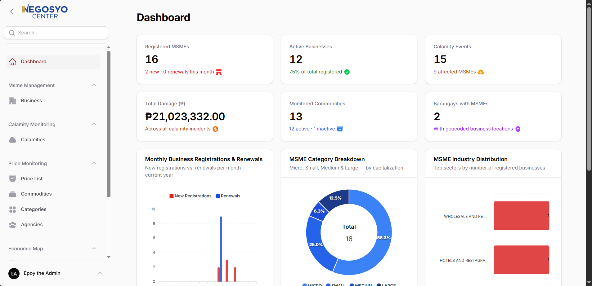
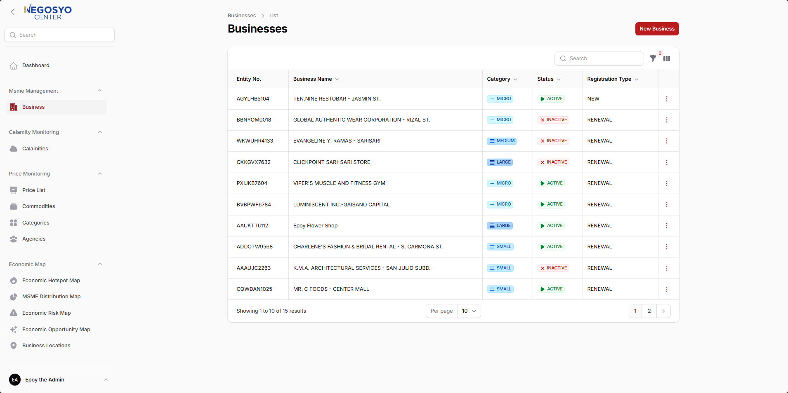
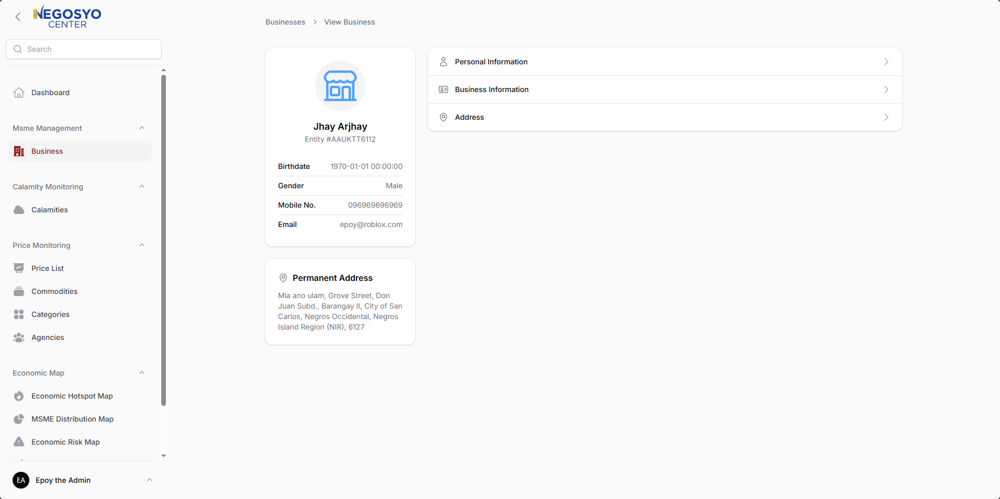
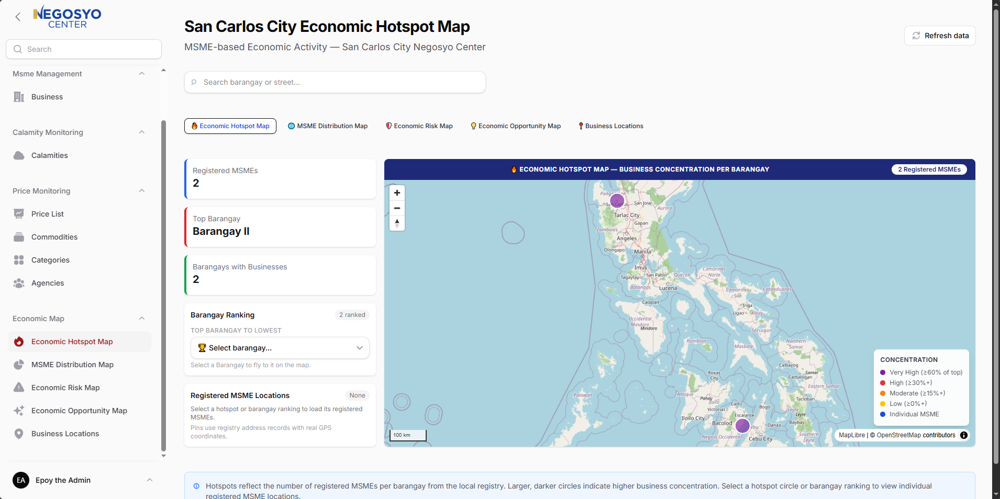
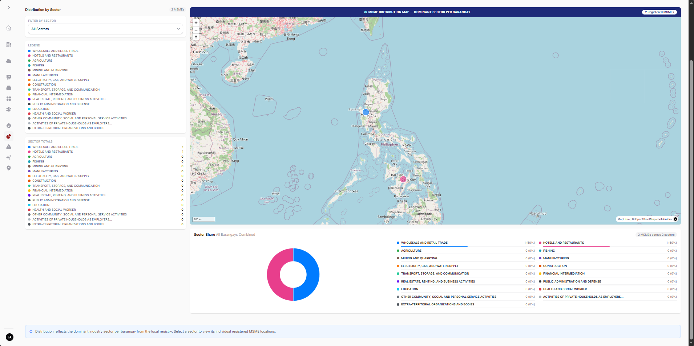
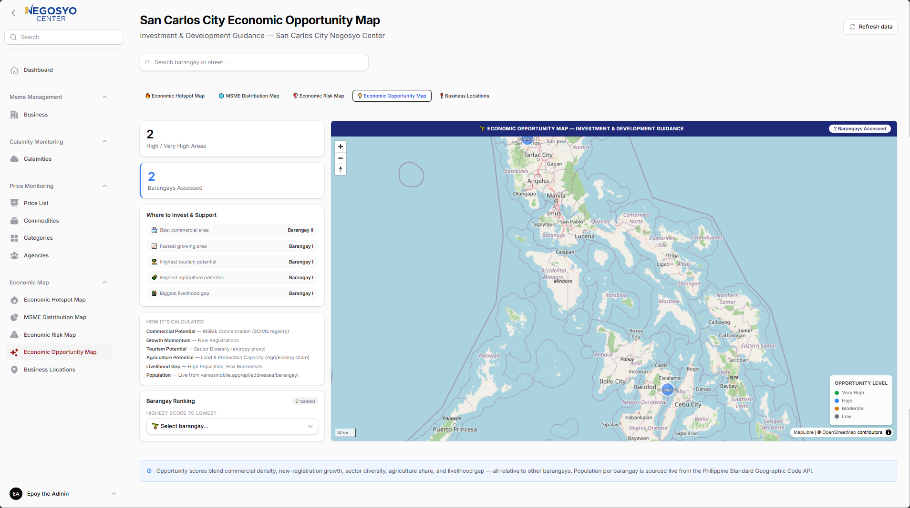
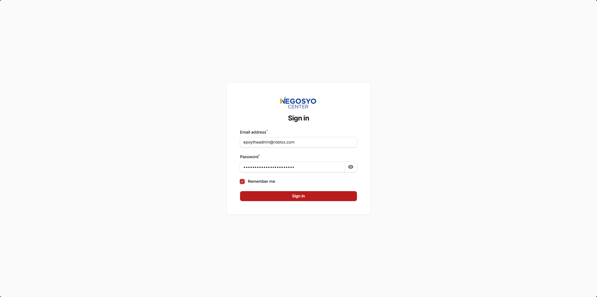

<p align="center">
  
</p>

<p align="center"><strong>MSME registry and economic mapping for the San Carlos City Negosyo Center</strong></p>

<p align="center">
  
  
  
  
  
  
</p>

## About

NegosyoTrack is a web-based management system built for the San Carlos City Negosyo Center, digitizing how the local government unit tracks, supports, and plans around its micro, small, and medium enterprises (MSMEs). It runs on Laravel with a Filament administration panel. Business and address records are read from the external SCIMS juridical API; calamity monitoring and price monitoring data remain in MySQL.

At its core is the MSME registry: juridical businesses and their addresses. The registry list and profile views query SCIMS directly; address reference selects use the Philippine address API.

Built on top of the registry is the Economic Map module — interactive MapLibre-powered maps turning SCIMS records into decision support: hotspot, distribution, risk, and opportunity views. SCIMS provides address text but no latitude/longitude, so aggregate maps plot barangays at configurable centres and individual pins are shown only when real coordinates exist. The risk view is a true MapLibre heat layer — the blur is risk intensity, red where barangays are most risk-prone and blue where least, and each barangay's marker dot carries the exposure × damage risk band. Calamity monitoring (events, incidents, damage costs) feeds the risk model, and price monitoring (agencies, commodities, prevailing vs. SRP prices) covers market oversight. One workspace for registration, disaster response, market monitoring, and economic planning.

## Features

### Command Dashboard

At-a-glance KPIs on login — registered and active MSMEs, calamity events with affected-business counts, total recorded damages, and monitored commodities — above monthly registration/renewal, category-breakdown, and industry-distribution charts.



### MSME Registry

Businesses and addresses with list and profile views, search, and status badges — sourced from SCIMS.



### Business Profiles

Full record view across owner, business, and address sections, queried from SCIMS by entity number.



### Economic Hotspot Map

Business concentration per barangay with ranked lists, per-barangay drill-down pins, and area search with summaries.



### Industry Distribution Map

Seventeen-sector breakdown with a filterable sector list, legend, totals, and a combined sector-share view.



### Economic Opportunity Map

Investment and development guidance per barangay — commercial density, new-registration growth, sector diversity, agriculture share, and livelihood gaps scored transparently, with a "where to invest & support" highlights board and live population data.



### Business Locations Directory

A read-only, searchable directory of SCIMS businesses with formatted addresses, barangay, industry, and registration status. Selecting a row opens the business profile.

### Sign-in



## Tech Stack

| Layer | Technology |
|---|---|
| Language | PHP 8.4 |
| Framework | Laravel 13 |
| Admin panel | Filament 5 (Livewire 4) |
| Database | MySQL |
| Maps | MapLibre GL 6 (vendored, OSM raster tiles) |
| Charts | Chart.js 4 |
| Styling | Tailwind CSS 4 |
| Build | Vite |

## Data Sources

| Source | Used for |
|---|---|
| SCIMS juridical API (`ScimsJuridicalApiService`) | Business list, business profiles, and address fields |
| MySQL | Calamity events/incidents, price monitoring, users, cache, and queues |
| `AddressApiService` | Philippine region/province/city/barangay reference data and population |

The Economic Map reads a cached SCIMS snapshot. Refresh it manually or let the scheduler keep it current:

```bash
php artisan economic-map:sync
php artisan schedule:work   # or run the scheduler in production
```

The map's “Refresh data” action queues the same sync job, so run a queue worker (`php artisan queue:work`) where background jobs are enabled. The snapshot is stored in a dedicated file cache (`storage/framework/cache/economic-map`) so multi-megabyte SCIMS payloads never hit the MySQL cache. Set `ECONOMIC_MAP_CACHE_STORE` to another Laravel cache store if needed.

## Getting Started

```bash
# 1. Install dependencies
composer install
npm install

# 2. Configure environment
cp .env.example .env
php artisan key:generate
# → set DB_CONNECTION, DB_HOST, DB_PORT, DB_DATABASE, DB_USERNAME, DB_PASSWORD

# 3. Build frontend assets
npm run build

# 4. Migrate (full schema ships in database/migrations)
php artisan migrate

# 5. Warm the Economic Map snapshot
php artisan economic-map:sync

# 6. Serve (or use Laravel Herd: https://herd.laravel.com)
php artisan serve
```

Then sign in at the app URL with an existing user account.

## Project Structure

```text
app/
├── Filament/
│   ├── Pages/EconomicMap/        # Hotspot, Distribution, Risk, Opportunity, Business Locations
│   ├── Pages/Msme/               # SCIMS business list and profile
│   └── Resources/                # Calamity and price monitoring resources
├── Jobs/
│   └── SyncEconomicMapData.php   # Queued SCIMS snapshot refresh
├── Console/Commands/
│   └── SyncEconomicMap.php       # economic-map:sync
├── Services/
│   ├── ScimsJuridicalApiService.php # SCIMS business + address client
│   ├── AddressApiService.php     # Philippine address reference data
│   ├── AddressManager.php        # Cascading dropdown orchestration
│   ├── EconomicMapService.php    # Map aggregates (hotspot, distribution, search)
│   └── EconomicMap/CalamityFeed.php  # MySQL damage history feed
├── Enums/
│   └── Industries.php            # Canonical 17-sector list
config/
└── economic-map.php              # Map bands, sector colors, cache TTL, barangay centres
```

## License

Proprietary — internal use of the San Carlos City Government. All rights reserved. Unauthorized copying, distribution, or use outside the Negosyo Center is prohibited.
